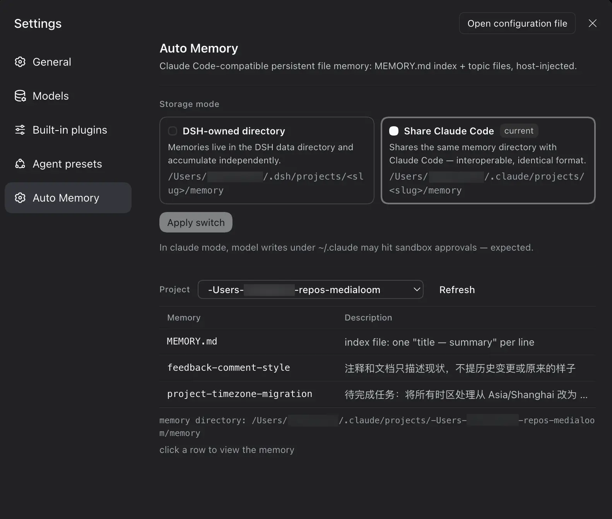

<p align="center">
  
</p>

<div align="center">


# dsh-cc-auto-memory

**Claude Code's auto memory, packaged as a lightweight plugin for DeepSeek Harness (DSH): persistent, file-based memory.**

[](https://www.npmjs.com/package/dsh-cc-auto-memory)
[](./LICENSE)
[](./README.md)
[](./README.zh-CN.md)

</div>

At the start of each session, memory-usage instructions and the `MEMORY.md` index are injected automatically; the model manages memory files with the plain `read` / `write` / `edit` tools — no dedicated memory tools are registered. The on-disk format is identical to Claude Code's, so memories are directly interoperable between the two (`claude` mode even shares the exact same directory).

## Installation

Web (CLI):

```
dsh plugin --profile web add dsh-cc-auto-memory
```

Desktop: open the in-app **Plugins** page and search for `dsh-cc-auto-memory`.

## Mechanism

A faithful port of [Claude Code's native auto memory](https://code.claude.com/docs/en/memory) — see the official docs for the original mechanism. Per session it works like this:

```
session start
    │
    ▼
host injects into the system prompt:
  • Memory usage instructions (with the memory dir path)
  • MEMORY.md index — first 200 lines / 25 KB
    │
    │   the model manages memory with the
    ▼   plain read / write / edit tools
memory dir — one per git repo
  MEMORY.md     ← index: one line per memory
  <topic>.md    ← one memory per file
    │
    │   after each write/edit, the host backstops:
    ▼   `modified` timestamp · index size limits
next session recalls the refreshed index … loop
```

- Subagent sessions get no main-session memory injected (same as Claude Code).
- Project resolution: git repository root (cwd when outside a repo), `/` → `-` in the slug; one shared memory per repository.

## Viewer panel

Settings → Auto Memory (read-only viewing; editing/creating/deleting is left to the agent's file tools during a session):

- **Storage mode**: two mode cards (dsh standalone directory / claude reuse) plus an "Apply switch" button — switching only takes effect for new sessions:
  - `dsh` (default): `$DSH_HOME/projects/<slug>/memory/`
  - `claude`: `~/.claude/projects/<slug>/memory/` (`CLAUDE_CONFIG_DIR` respected) — shares the same memory with Claude Code, interoperable both ways

  > In claude mode, the model's write/edit calls into `~/.claude/` fall outside the session workspace and trigger approvals per the session sandbox policy — this is expected.
- **Project list filtered by the active mode**: dsh mode shows only projects under `$DSH_HOME`; claude mode shows only projects under `~/.claude`
- **Memory table**: **click any row to open a floating card** showing the raw file content (plain text, Markdown not rendered); Esc or clicking the overlay closes it

<p align="center">
  
</p>

## Configuration

`cordis.patch.yml` can be overridden at the user layer:

| Field | Default | Description |
|---|---|---|
| `mode` | `dsh` | Storage mode `dsh` / `claude` |
| `claudeConfigDir` | `''` | Claude Code config root for claude mode; empty = `$CLAUDE_CONFIG_DIR` or `~/.claude` |
| `maxIndexLines` | `200` | Line limit when reading `MEMORY.md` |
| `maxIndexBytes` | `25600` | Byte limit when reading `MEMORY.md` |

## License

[MIT](./LICENSE)
