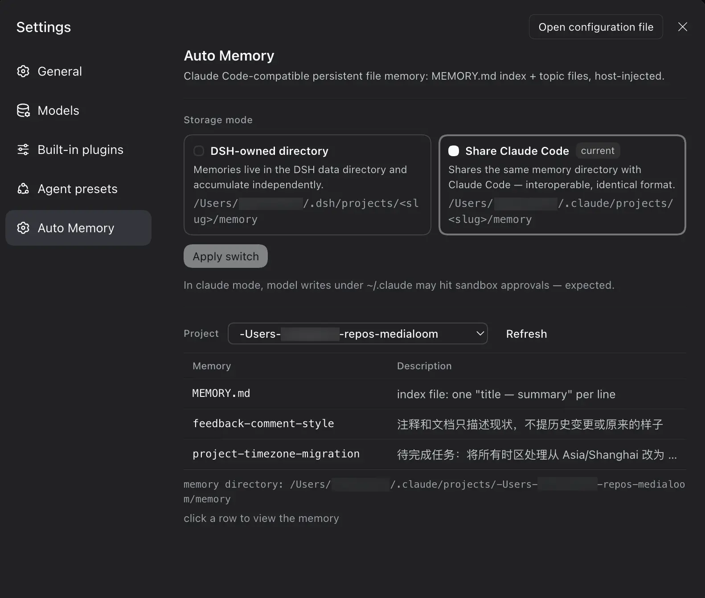

<div align="center">


# dsh-cc-auto-memory

**把 Claude Code 的 auto memory 机制原样带到 DeepSeek Harness（DSH）的轻量级记忆插件：纯文件的持久化记忆。**

[](https://www.npmjs.com/package/dsh-cc-auto-memory)
[](./LICENSE)
[](./README.md)
[](./README.zh-CN.md)

</div>

每个会话开始时会自动注入使用说明和 `MEMORY.md` 索引，模型直接用普通的 `read` / `write` / `edit` 文件工具管理记忆文件，不注册任何专用 memory 工具。落盘格式与 Claude Code 完全一致，两边记忆可直接互通（`claude` 模式甚至直接共享同一个记忆目录）。

## 安装

Web 端（命令行）：

```
dsh plugin --profile web add dsh-cc-auto-memory
```

桌面版：打开应用内 **Plugins（插件）** 页，搜索 `dsh-cc-auto-memory` 安装。

## 机制

机制上是对 [Claude Code 原生 auto memory](https://code.claude.com/docs/zh-CN/memory) 的忠实移植，原始机制可参考官方文档。每个会话的运作流程：

```
session start
    │
    ▼
host injects into the system prompt:
  • Memory usage instructions (with the memory dir path)
  • MEMORY.md index — first 200 lines / 25 KB
    │
    │   the model manages memory with the
    ▼   plain read / write / edit tools
memory dir — one per git repo
  MEMORY.md     ← index: one line per memory
  <topic>.md    ← one memory per file
    │
    │   after each write/edit, the host backstops:
    ▼   `modified` timestamp · index size limits
next session recalls the refreshed index … loop
```

- 子代理（subagent）会话不注入主会话记忆（与 Claude Code 一致）。
- 项目定位：git 仓库根目录（仓库外用 cwd），路径中 `/` 替换为 `-` 作为 slug，同一仓库共享一份记忆。

## 查看面板

Settings → Auto Memory（只读查看，编辑/新建/删除交给会话中的 Agent 用文件工具完成）：

- **存储模式**：两张模式卡片（dsh 独立目录 / claude 复用）＋「应用切换」按钮，切换只对新会话生效：
  - `dsh`（默认）：`$DSH_HOME/projects/<slug>/memory/`
  - `claude`：`~/.claude/projects/<slug>/memory/`（尊重 `CLAUDE_CONFIG_DIR`），与 Claude Code 共享同一份记忆，双向互通

  > claude 模式下，模型通过 write/edit 写 `~/.claude/` 位于会话工作区之外，会按会话沙箱策略触发审批，属预期行为。
- **项目列表按当前模式过滤**：dsh 模式只显示 `$DSH_HOME` 下的项目，claude 模式只显示 `~/.claude` 下的项目
- **记忆表格**：**点击任意行弹出悬浮卡片**展示文件原文（纯文本，不渲染 Markdown），Esc 或点击遮罩关闭



## 配置

`cordis.patch.yml` 用户层可覆盖：

| 字段 | 默认 | 说明 |
|---|---|---|
| `mode` | `dsh` | 存储模式 `dsh` / `claude` |
| `claudeConfigDir` | `''` | claude 模式的 CC 配置根；空 = `$CLAUDE_CONFIG_DIR` 或 `~/.claude` |
| `maxIndexLines` | `200` | MEMORY.md 读取行数上限 |
| `maxIndexBytes` | `25600` | MEMORY.md 读取字节上限 |

## 许可

[MIT](./LICENSE)
